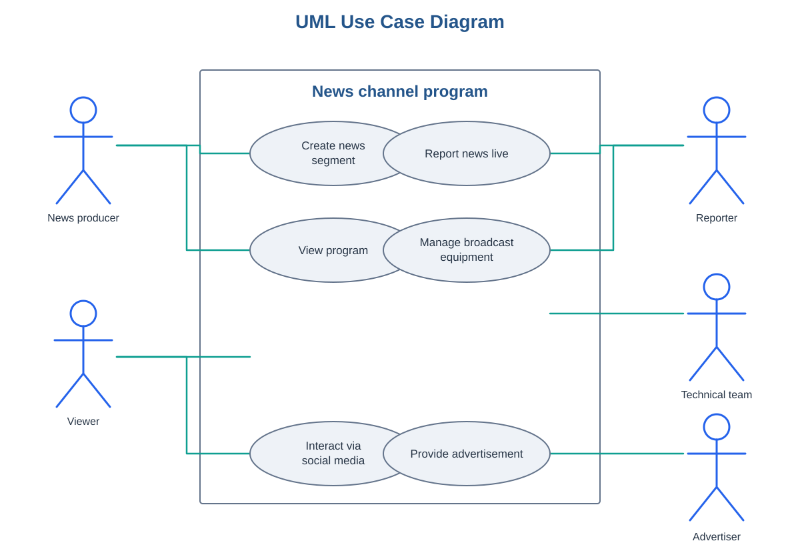

# News Channel Program — Use Case Modeling

A practical Business Analysis exercise completed as part of the **IBM Business Analyst Professional Certificate**, in the module covering process modeling, diagrams, and use cases.

The case study models the production, live broadcast, and audience engagement activities of a television news program.

## Project overview

- **System:** News channel program
- **Actors:** 5 (2 primary, 3 secondary)
- **Use cases:** 6
- **Actor–use case relationships:** 8
- **Tools:** Lucidchart and Microsoft Word

## Use case diagram

The diagram identifies the system boundary, places actors outside the system, and maps their associations with the six use cases. The news producer and reporter share responsibilities in preparing a news segment and coordinating live coverage; their distinct contributions are documented in the relationship analysis.

[Open the interactive diagram in Lucidchart](https://lucid.app/lucidchart/7390e644-b2a4-4605-9f86-4769b1048ace/edit?viewport_loc=-1254%2C-430%2C3877%2C2181%2C0_0&invitationId=inv_35b30263-e9a3-411a-b19a-b6acc66fbd94)

## Actors

| Actor | Type | Role |
|---|---|---|
| News producer | Primary | Plans segments, selects topics, assigns reporters, and coordinates live coverage. |
| Reporter | Primary | Gathers information, conducts interviews, contributes stories, and reports live. |
| Viewer | Secondary | Watches the broadcast and shares comments or feedback through social media. |
| Technical team | Secondary | Sets up, maintains, and troubleshoots broadcast equipment. |
| Advertiser | Secondary | Submits advertisements and coordinates their placement. |

## Use cases

| Use case | Description |
|---|---|
| Create news segment | Select a topic, gather material, and assign a reporter to prepare a segment. |
| Report news live | Deliver news, interviews, and updates on air as events unfold. |
| View program | Watch the live news broadcast. |
| Interact via social media | Comment on stories, share feedback, or participate in a discussion. |
| Manage broadcast equipment | Prepare and check cameras, microphones, and broadcast software, and resolve faults. |
| Provide advertisement | Submit an advertisement and coordinate when it will air during a commercial break. |

## Actor–use case relationships

| Actor | Use case | Participation |
|---|---|---|
| News producer | Create news segment | Plans and develops the segment. |
| News producer | Report news live | Supports the broadcast by coordinating with reporters. |
| Reporter | Report news live | Delivers the story on air. |
| Reporter | Create news segment | Contributes interviews and information for the segment. |
| Viewer | View program | Watches the live broadcast. |
| Viewer | Interact via social media | Comments on the program and gives feedback. |
| Technical team | Manage broadcast equipment | Checks equipment and resolves technical problems. |
| Advertiser | Provide advertisement | Submits an ad and coordinates placement. |

## Key learning

A use case diagram provides a high-level view of system scope and actor interactions. The accompanying relationship analysis adds context by explaining each actor's contribution. This is especially useful when multiple stakeholders participate in the same use case but have different responsibilities.

## Deliverables

- [Use case analysis and relationship documentation](./use-case-analysis.md)
- [Use case diagram (SVG)](./diagrams/use-case-diagram.svg)
- [Interactive Lucidchart diagram](https://lucid.app/lucidchart/7390e644-b2a4-4605-9f86-4769b1048ace/edit?viewport_loc=-1254%2C-430%2C3877%2C2181%2C0_0&invitationId=inv_35b30263-e9a3-411a-b19a-b6acc66fbd94)

*This is an educational case study completed for professional development. It is not a production system specification.*
